# BeatSync App - Synchronisation de Playlists YouTube vers Spotify

  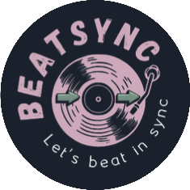

## Description

BeatSync est une application full-stack (Python/Flask + React/Vite, MongoDB, SQLAlchemy/PostgreSQL) permettant de synchroniser automatiquement une playlist YouTube vers Spotify.

L'application repose sur :

- une authentification OAuth 2.0 via Spotify
- une gestion sécurisée des tokens côté backend (MongoDB)
- une base PostgreSQL pour l’historique des synchronisations
- la structuration d’un backend en architecture MVC enrichie d’une couche Service
- la mise en place d’une architecture frontend/backend découplée

L'objectif principal est de se familiariser avec :

- l'utilisation d'APIs REST (YouTube et Spotify),
- l'authentification OAuth,
- la gestion des tokens sécurisée côté serveur
- la structuration d'un projet en architecture MVC (Models, Controller, Views),
- la recherche intelligente de morceaux sur Spotify avec correspondance titre/artiste.
- la création d'une interface web en React.

## Fonctionnalités

- Extraire les titres et artistes d'une playlist YouTube
- Créer une nouvelle playlist sur Spotify
- Rechercher les morceaux sur Spotify avec un score de correspondance
- Ajouter les morceaux trouvés à la playlist Spotify
- Interface web avec connexion Spotify sécurisée, saisie d’URL YouTube, et suivi de la synchronisation

## Technologies principales

- **Backend :** Python, Flask, Spotipy, Google API Client
- **Frontend :** React (JS, Vite)
- **BDD :**
  - MongoDB (stockage sécurisée des tokens Spotify)
  - PostgreSQL (historique des synchronisations)
- **Tests :** Pytest, Postman
- **CI/CD :** GitHub Actions
- **Gestion de projet :** Trello, Figma
- **Déploiement :**  Docker & Render

## Architecture du projet

### Backend (Flask API)

Le backend suit une architecture en couches :

- **Controllers**

  - `sync_controller`
  - `history_controller`
    → Gestion des requêtes HTTP et des sessions
- **Services**

  - `sync_service`
  - `token_service`
  - `mongo_tokens`
  - `user_service`
    → Logique applicative et orchestration
- **Models**

  - `synchronizer`
  - `spotify_model`
  - `youtube_model`
    → Logique métier et intégration API
- **sql_models**

  - `User`
  - `SyncJob`
  - `SyncRun`
    → Entités ORM PostgreSQL

### Frontend (React)

- Gère l’interface utilisateur
- Implémente les "Views"
- Communique avec le backend via requêtes HTTP (API REST)
- Pages principales :
  - Login
  - Dashboard
  - History
  - History Detail
  - Privacy
  - CGU
  - NotFound
  - AlreadyConnected

## Prérequis

- Python 3.9 ou supérieur (la version utilisée dans ce projet : 3.13.3)
- Un compte Spotify avec une application enregistrée pour obtenir Client ID et Client Secret
- Une clé API YouTube
- Modules Python :
  - `spotipy`
  - `python-dotenv`
  - `google-api-python-client` (pour YouTube)
  - `flask`
- Modules React :
  - `npm create vite@latest youtube-to-spotify-front --template react`
  - `npm install`

## Installation

1. Cloner le projet :
   `git clone <URL_DU_REPO>`
2. Créer un environnement virtuel et l'activer :

   - `python -m venv venv`
   - `source venv/bin/activate`   # Linux/Mac
   - `.\venv\Scripts\activate`    # Windows
3. Installer les dépendances :

   - `pip install -r requirements.txt`
   - `pip freeze > requirements.txt` (pour mettre à jour les dépendances)
4. Créer un fichier `.env.local` (voir fichier .env) avec :

   - SPOTIFY_CLIENT_ID=...
   - SPOTIFY_CLIENT_SECRET=...
   - SPOTIFY_REDIRECT_URI=...
   - SPOTIFY_USER_ID=...
   - YOUTUBE_API_KEY=...
   - FLASK_SECRET_KEY=
   - MONGO_URI=
   - DATABASE_URL=
   - FRONTEND_URL=

## Utilisation

- Backend :

1. Se positionner dans le dossier `backend` :
2. `python app.py`
3. Entrer l'URL de la playlist YouTube quand demandé
4. L'application créera la playlist sur Spotify et ajoutera les morceaux trouvés

- Frontend :

1. Se positionner dans le dossier `frontend` :
   `npm run dev`
2. Ouvrir l'URL `http://127.0.0.1:5173/` dans le navigateur

## Points importants

- Certains morceaux peuvent ne pas être trouvés si le nom ou l'artiste est trop différent
- Les vidéos YouTube provenant de chaînes "Topic" ou dont le titre est peu clair peuvent parfois ne pas être parfaitement reconnues par Spotify.
- L’API YouTube peut renvoyer des vidéos "fantômes" (supprimées, privées ou non listées)
  si elles sont encore référencées dans la playlist. Ces vidéos peuvent ne plus apparaître dans l’interface YouTube, mais être comptées dans la requête API. Elles peuvent provoquer des écarts dans le nombre de morceaux importés.
- La synchronisation inverse pourrait également être envisageable : à partir d'une playlist Spotify, nous pouvons récupérer les vidéos YouTube correspondantes et les ajouter à une playlist YouTube. Cela nécessite d'obtenir l'autorisation OAuth via l'API YouTube.
- La connexion OAuth Spotify est opérationnelle : le front redirige correctement vers Spotify et revient sur le dashboard une fois l’autorisation validée.
- Stockage des tokens dans MongoDB pour renforcer la sécurité et permettre une authentification plus fiable.

## Fonctionnalités détaillées

### Authentification

- Connexion OAuth 2.0 via Spotify
- Stockage sécurisé des tokens en MongoDB
- Refresh automatique des tokens expirés

### Synchronisation

- Extraction des titres/artistes depuis YouTube
- Recherche intelligente avec scoring Spotify
- Création automatique de playlist
- Gestion des morceaux non trouvés

### Historique

- Enregistrement de chaque synchronisation
- Liste des synchronisations passées
- Page détail avec :
  - Morceaux ajoutés
  - Morceaux non trouvés
  - Statut (SUCCESS / FAILED)
  - Date de début / fin

### Pages

- Login
- Dashboard
- AlreadyConnected
- History
- History Detail
- Privacy Policy (Politique de Confidentialité)
- CGU (Conditions Générales d’Utilisation)
- NotFound (404)

## Déploiement prévu

Le déploiement sera prochainement effectué :

- sur **Render**, pour héberger le backend Flask et le frontend React, accessible via une URL publique
- en **complément avec Docker**, pour créer un conteneur isolé contenant l’application complète et toutes ses dépendances, facilitant le test et la portabilité sur d’autres environnements

Les instructions détaillées de déploiement (Dockerfile, configuration Render, etc.) seront ajoutées après la finalisation de ces fonctionnalités.

## Organisation du projet

- Cahier des charges : [PDF](https://github.com/RukenDogan/youtube_to_spotify/tree/main/docs-images/CAHIER_DES_CHARGES_BeatSyncApp.pdf)
- Formalisation des besoins fonctionnels en User Stories (Kanban) : [lien Trello](https://trello.com/b/bj08OaGH/formalisation-des-besoins-fonctionnels-en-user-stories-beatsync-app)
- Gestion de projet (méthode Kanban) : [lien Trello](https://trello.com/invite/b/68e4cd834914b08442301ac4/ATTI16bcee34f742fc93b408b9e6ff2bba5e6B03E2A1/gestion-de-projet-youtube-spotify)
- Création de maquettes avec Figma pour les pages Login et Dashboard : [lien Figma](https://www.figma.com/design/NAmYPrvKnnxLt6XkuWXm5A/Pages-Login-et-Dashboard-youtube-spotify?node-id=0-1&p=f&t=DaXgRIgKQMHaadRD-0)

## Tests

- **Tests automatisés (CI/CD)** : exécutés avec GitHub Actions à chaque commit/pull request
- **Tests unitaires** : avec `pytest` dans le dossier `backend/tests`
- **Tests manuels** :

  - via **Postman** pour tester les endpoints
  - via le **terminal**
- Test de la route avec Postman :

 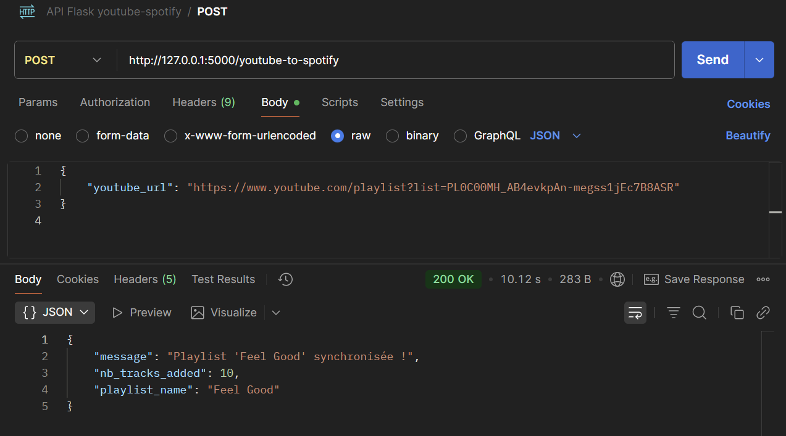

- Test de la route dans le terminal :

 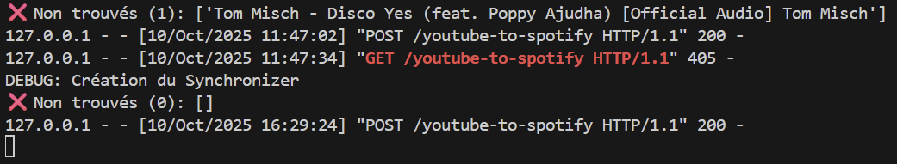

## Sécurité

- Tokens Spotify stockés uniquement côté backend (MongoDB)
- Aucun token exposé côté navigateur
- Variables sensibles via environnement (.env.local / Render)
- Gestion sécurisée des sessions Flask
- HTTPS automatique via Render (à venir)

## Aperçu visuel

**Côté backend**

- Lancement du script `main.py` :
  Exemple d’exécution dans le terminal lors de la synchronisation :

  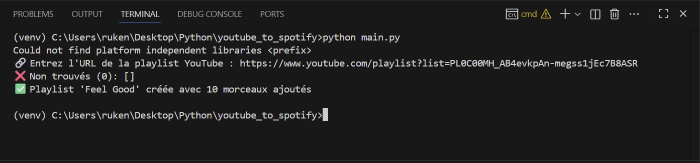

Résultat sur Spotify :
Playlist créée automatiquement :

  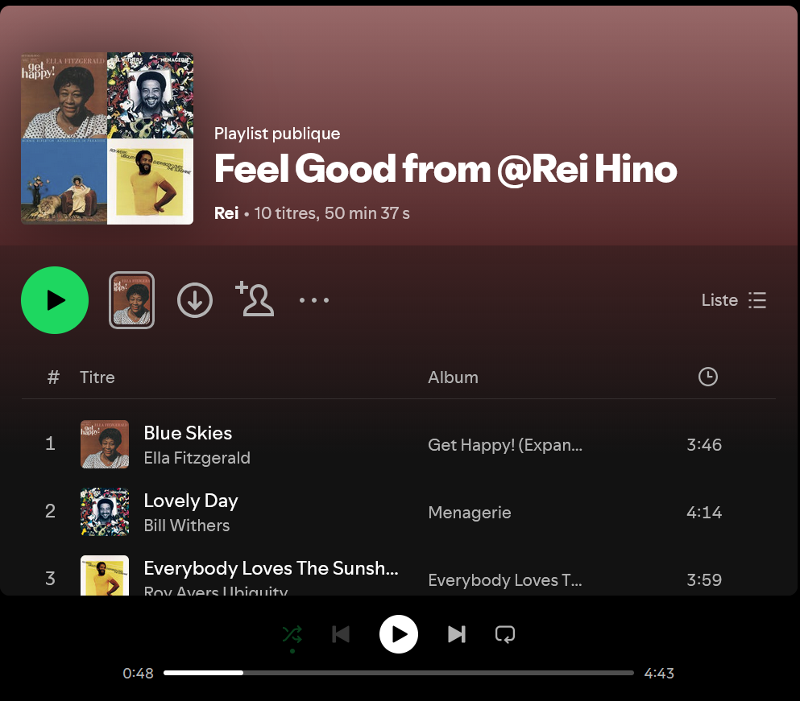

**Côté frontend (React)**

- Se placer dans le dossier `frontend` et lancer `npm run dev` :

**Page de connexion** **(Login)** :
Page d’accueil invitant l’utilisateur à se connecter à son compte Spotify :

  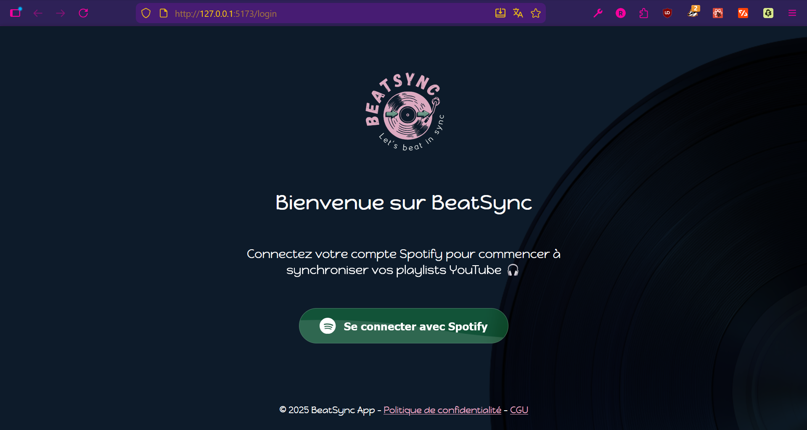

***Page de redirection OAuth Spotify** :*
 Interface de connexion OAuth Spotify :

  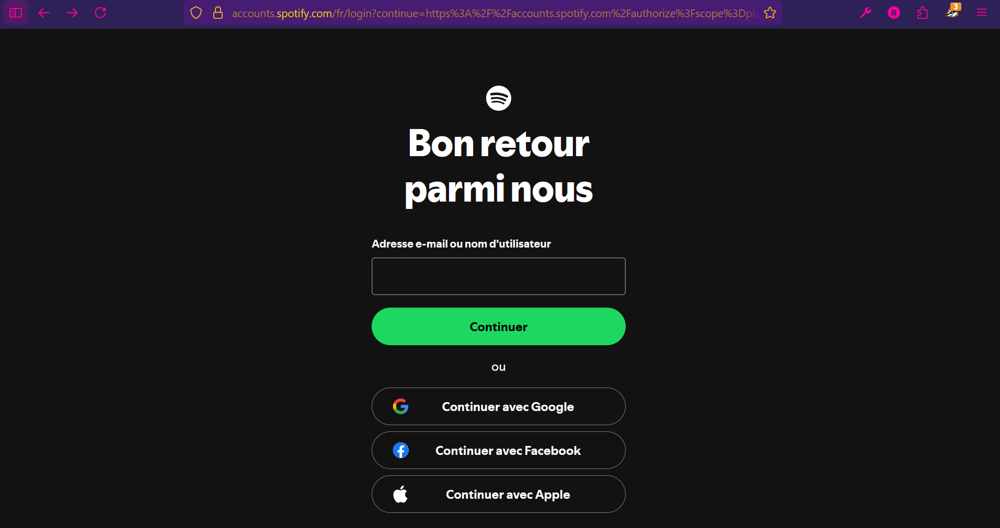

**Page Dashboard** :
Interface principale pour synchroniser les playlists YouTube → Spotify :

  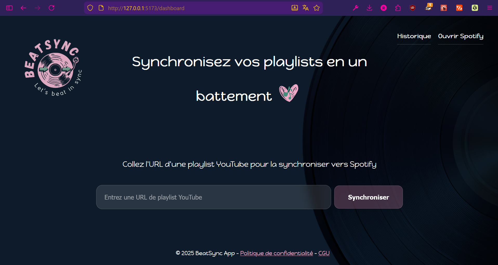

**Page NotFound** :
Gère les erreurs de connexion ou les routes inexistantes :

  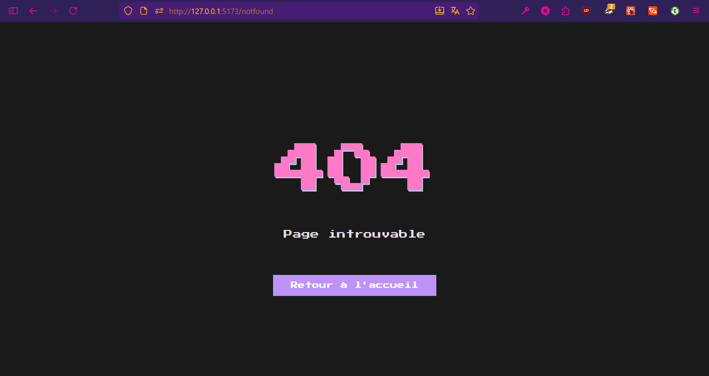

**Page AlreadyConnected :**
Page de redirection qui s'affiche si l'utilisateur est déjà connecté à Spotify.
Elle apparaît lorsqu’un utilisateur clique sur **“Se connecter à Spotify”** depuis la page Login alors que sa session OAuth est toujours active.
Cette page sert de transition avant de rediriger automatiquement l’utilisateur vers le **Dashboard**, évitant ainsi de refaire une authentification inutile :

  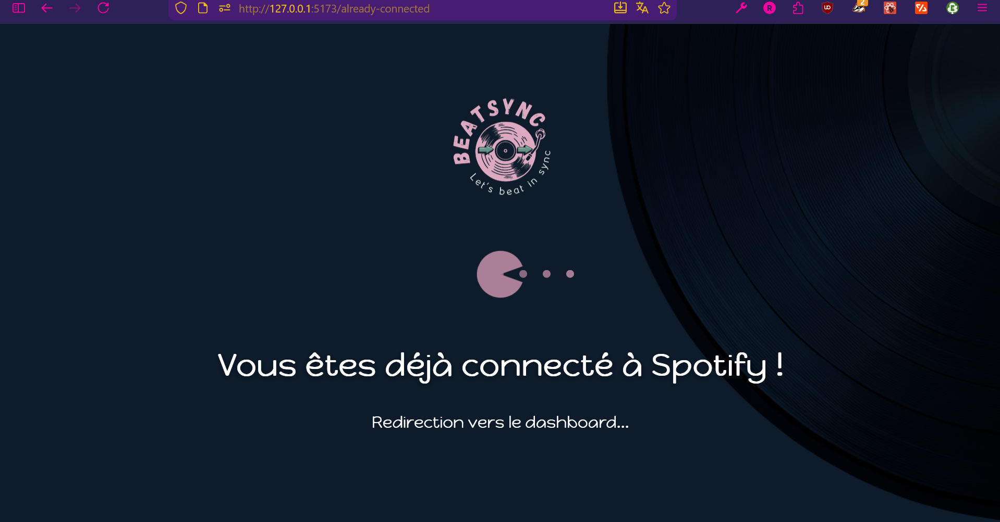

* **Flux utilisateur simplifié :**
  `Login → (OAuth Spotify / AlreadyConnected selon session) → Dashboard`
* Permet d’améliorer l’expérience utilisateur en évitant de demander une nouvelle autorisation si l’utilisateur est déjà connecté.

**Page Privacy :**
Cette page informe l’utilisateur sur la gestion de ses données personnelles et sur la manière dont BeatSync utilise les informations de Spotify et YouTube :

  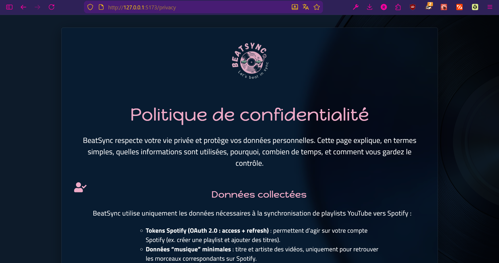

**Page Terms :**
Cette page définit le cadre d’utilisation de l’application BeatSync (Condition Général d'Utilisation)

  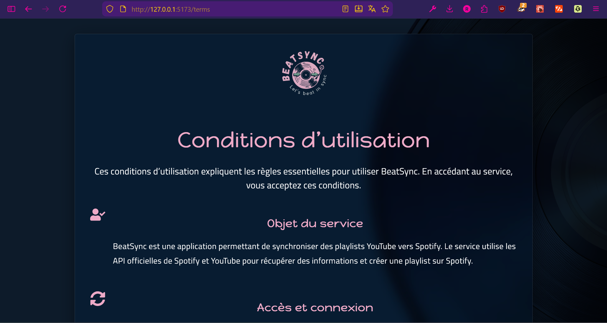 

**Page History :**
Cette page permet à l’utilisateur de consulter l’historique de ses synchronisations précédentes.

  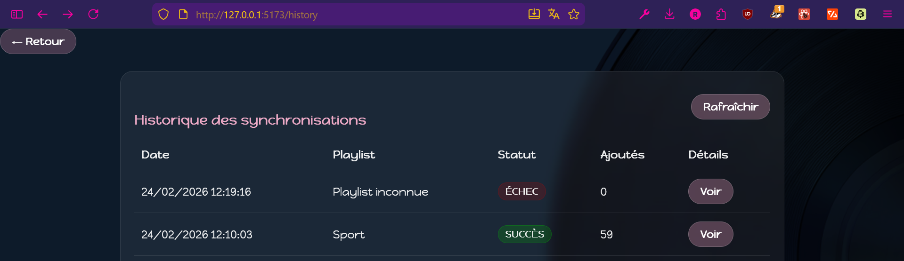 

**Page HistoryDetail :**
Cette page affiche le détail d’une synchronisation spécifique.

  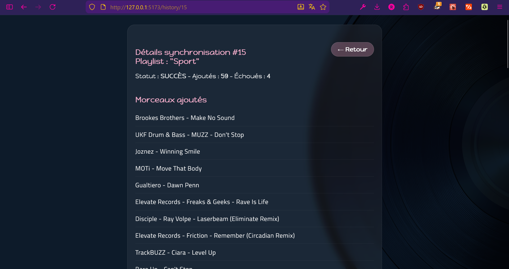 

  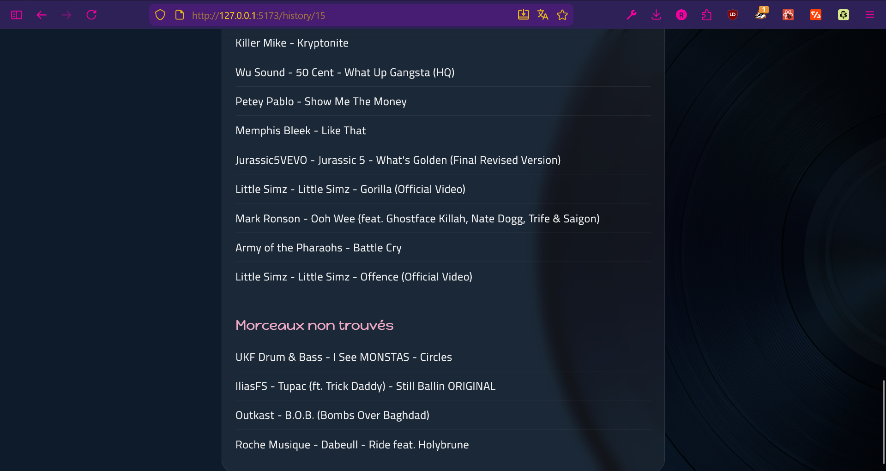 

  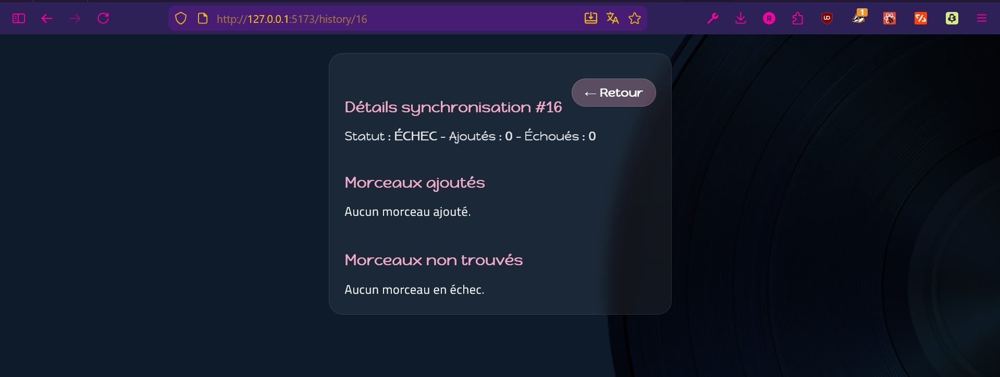 

#### Gif Visuel :

  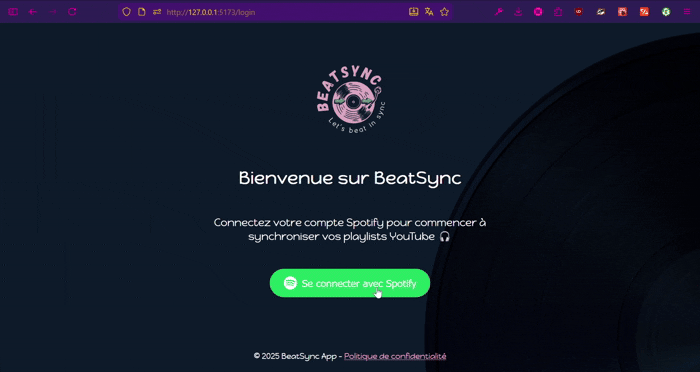

#### Demo de BeatSync

Cette vidéo présente le fonctionnement de l'application BeatSync :

- connexion à Spotify via OAuth 2.0
- redirection vers l'interface utilisateur après authentification
- synchronisation d'une playlist YouTube vers Spotify
- création automatique de la playlist Spotify
- affichage du résultat de synchronisation (morceaux trouvés / non trouvés)
- consultation de l'historique des synchronisations

La démonstration est réalisée en navigation privée afin de montrer le processus complet d’authentification OAuth.

▶ Voir la démonstration :

  

---

### Source images :

- **Image de fond** : [Vecteezy – Vinyle classique
  ](https://es.vecteezy.com/png/49662375-clasico-vinilo-grabar-dto-textura)--> Image d’origine téléchargée sur Vecteezy, **découpée et ajustée** pour n’en conserver qu’une partie.
- **Logo BeatSync** : réalisé à partir d’un modèle Canva, avec modifications personnelles (couleurs, texte, ajout de flèches)
- **Icône de cœur battant** (Dashboard) : composition d’éléments Canva (couleurs modifiées)

  Les modifications graphiques (découpe, transparence, GIF) ont été réalisées avec des outils en ligne.

---

Projet réalisé par Ruken Dogan
